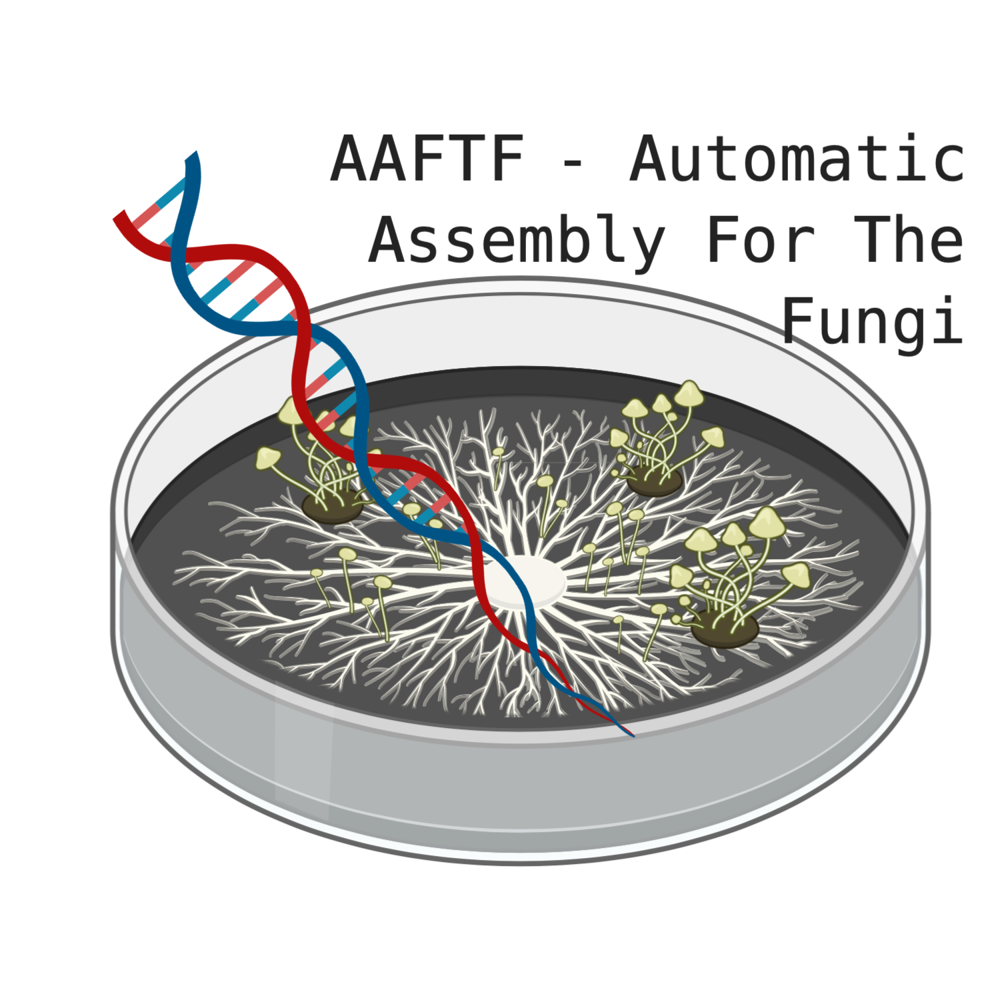

[](https://github.com/stajichlab/AAFTF/actions/workflows/ci.yml)
[](https://github.com/stajichlab/AAFTF/actions/workflows/ci.yml)
[](https://github.com/stajichlab/AAFTF/blob/main/LICENSE)
[](https://pypi.org/project/AAFTF/)
[](https://github.com/stajichlab/AAFTF/pkgs/container/aaftf)
[](https://aaftf.readthedocs.io/en/latest/)

# AAFTF - Automatic Assembly For The Fungi
*Authors: Jason Stajich, Jon Palmer and Cheng-Hung Tsai*



AAFTF automates draft genome assembly from Illumina short reads (optionally with long reads), with
read trimming and contaminant filtering, assembly, vector and contaminant screening of contigs,
duplicate removal, contig sorting and renaming, and summary statistics including telomere detection.
Each step is a subcommand that can be run on its own, or all together with `AAFTF pipeline_short` (Illumina), `pipeline_long` (ONT/PacBio) or `pipeline_hybrid`.

**Documentation:** <https://aaftf.readthedocs.io/en/latest/>

# Requirements
Python >=3.10 and the external tools below. Everything can be installed with conda (bioconda) or
pixi (see Install). Run `AAFTF dependency` to see which tools are found and which are missing.

**Needed by the pipelines** (`pipeline_short`, `pipeline_long` and `pipeline_hybrid`, i.e. `trim`,
`filter`, `assemble`, `polish`, `vecscreen`, `covpurge`, `rmdup`, `sort`, `assess` with the settings
the pipelines use by default):

- [BBTools](https://bbmap.org/) (`bbduk.sh`, `shuffle.sh`, `reformat.sh`; needs Java) - read trimming and contaminant filtering
- [SPAdes](https://github.com/ablab/spades) - assembly
- [NCBI BLAST+](https://ftp.ncbi.nlm.nih.gov/blast/executables/blast+/LATEST/) - vector/contaminant screening (`vecscreen`)
- [bwa](https://github.com/lh3/bwa) and [samtools](https://github.com/samtools/samtools) >=1.13 - read mapping for the `covpurge` coverage filter
- [minimap2](https://github.com/lh3/minimap2) - duplicate contig detection (`rmdup`)
- [Flye](https://github.com/mikolmogorov/Flye) - long-read assembly (`pipeline_long`, `pipeline_hybrid`)
- [Racon](https://github.com/lbcb-sci/racon), [Polypolish](https://github.com/rrwick/Polypolish), [pypolca](https://github.com/gbouras13/pypolca) + freebayes - polishing (`pipeline_long`, `pipeline_hybrid`)
- Python packages: biopython, psutil (and matplotlib for `depth` plots)

**Only needed for optional steps or non-default options:**

| Tool | Used by |
|---|---|
| [sourmash](https://sourmash.readthedocs.io/) >=4.8 ([paper](https://pubmed.ncbi.nlm.nih.gov/31508216/)) + [branchwater plugin](https://github.com/sourmash-bio/sourmash_plugin_branchwater) | `taxpurge` (run by the pipelines only with `-p/--phylum`; also needs its databases, see below) |
| [fastp](https://github.com/OpenGene/fastp), [Trimmomatic](https://github.com/usadellab/Trimmomatic) | `trim --method fastp` / `trimmomatic` |
| [bowtie2](http://bowtie-bio.sourceforge.net/bowtie2/index.shtml) | `filter --aligner bowtie2` (`bwa` and `minimap2` are the other alternatives) |
| [MEGAHIT](https://github.com/voutcn/megahit), [Unicycler](https://github.com/rrwick/Unicycler) | `assemble --method megahit` / `unicycler` (also `pipeline_short`/`pipeline_hybrid --method`) |
| [NOVOPlasty](https://github.com/ndierckx/NOVOPlasty) | `mito` (mitochondrial genome) |
| [NCBI FCS-adaptor](https://github.com/ncbi/fcs) (with singularity/apptainer or docker) | `fcs_screen` |
| [NCBI FCS-GX](https://github.com/ncbi/fcs-gx) ([paper](https://pubmed.ncbi.nlm.nih.gov/38409096/)) | `fcs_gx_purge` (needs RAM for the whole ~470 GB database) |
| [NextPolish2](https://github.com/Nextomics/NextPolish2) + yak | `polish --method nextpolish2` |
| [mosdepth](https://github.com/brentp/mosdepth) | `depth` |
| pigz | faster read counting (falls back to gzip) |

# Install
With conda, from a checkout of this repository:

```
# only what the `AAFTF pipeline_*` subcommands need with their default settings; installs AAFTF from PyPI
$ conda env create -f environment.yml && conda activate aaftf

# or every tool AAFTF can use, with AAFTF installed from this checkout (editable)
$ conda env create -f environment.dev.yml && conda activate aaftf-dev
```

Or with [pixi](https://pixi.sh), which uses the locked versions in `pixi.lock`:

```
$ pixi install -e complete        # environments: default, complete, dev
$ pixi shell -e complete
```

`default` has only the default-pipeline tools, `complete` adds every optional tool, and `dev` adds
the test and lint tools. The conda bowtie2 cannot use AVX2; for AVX2 speed rebuild it once with
`pixi run -e complete install-bowtie2` (`AAFTF dependency` tells you when this applies). See
`docs/installation.rst` for details, including the Docker and Singularity images.

## Reference databases
AAFTF caches its reference databases in `~/.cache/aaftf` unless `AAFTF_DB` is set. Some are several GB,
so point `AAFTF_DB` at a folder with plenty of space. It can list several folders separated by `:`,
like `$PATH`; databases are read from the first folder that has them and downloaded into the first
writable one. The steps only read databases; download them once with `AAFTF database`:
```
$ export AAFTF_DB=/path/with/space/aaftf_db   # or a shared, system-wide location
$ AAFTF database                                        # list databases and where they are stored
$ AAFTF database required     # what the default pipeline needs: phix univec contamdb
$ AAFTF database taxpurge     # sourmash databases for taxpurge (pipelines with -p), ~0.7 GB
```

`fcs_screen` also needs the FCS-adaptor script and container image (`AAFTF database fcs_script fcs_image`,
or pass `--fcs_script`/`--image`). `fcs_gx_purge` needs an FCS-GX database set up separately
(see the [FCS-GX wiki](https://github.com/ncbi/fcs/wiki/FCS-GX)) and passed with `-d/--db`;
run it on a node with enough memory for the database. A database on `/dev/shm` or fast storage is used
in place; otherwise it is copied to a per-job folder in `$TMPDIR` (`--copy_to`) for the run.

# Commands
`AAFTF -h` lists the subcommands in four groups.

**Setup**
- `dependency` - check that the external tools and Python packages are installed
- `database` - list or download the reference databases

**Steps** (in the order they are usually run)

| Step | Subcommand | What it does | Output |
|---|---|---|---|
| 1 | `trim` | Trim adaptors and low-quality reads - BBDuk (default), Trimmomatic or fastp | `<prefix>_1P.fastq.gz`, `<prefix>_2P.fastq.gz` |
| - | `mito` | (Optional) Assemble the mitochondrial genome with NOVOPlasty, to screen its reads out in `filter` | mitochondrial FASTA |
| 2 | `filter` | Remove PhiX, vector and other contaminant reads - BBDuk (default), bowtie2, bwa or minimap2 | `<prefix>_filtered_1.fastq.gz`, `<prefix>_filtered_2.fastq.gz` |
| 3 | `assemble` | Assemble - SPAdes, MEGAHIT, Unicycler or Flye (long reads); `--method` is required | assembly FASTA |
| 4 | `vecscreen` | BLAST-based vector/contaminant screen of contigs, following NCBI VecScreen | cleaned FASTA |
| 5 | `taxpurge` | Drop contigs sourmash classifies outside your phyla (`-p`); the pipelines run it only when given `-p` | purged FASTA |
| - | `fcs_screen` | (Optional; pipelines: `--fcs_screen`) NCBI FCS-adaptor vector screen | cleaned FASTA |
| 6 | `covpurge` | Drop contigs with low Illumina read coverage (bwa) | purged FASTA |
| 7 | `rmdup` | Remove duplicate and contained contigs (minimap2) | deduplicated FASTA |
| - | `polish` | (Optional) Polish with Polypolish (default), pypolca, NextPolish2 or Racon; recommended only with long reads | polished FASTA |
| 8 | `sort` | Sort contigs by length and rename them | final FASTA |
| 9 | `assess` | Assembly statistics (N50/L50, GC, gaps, soft-masking, telomeres) | printed (and a `-r` file) |
| - | `depth` | (Optional) Per-contig read depth (mosdepth), flagging outliers such as organelles or contaminants | coverage report and plots |

**Pipeline** (several steps in one command)

| Subcommand | What it does | Output |
|---|---|---|
| `pipeline_short` | Run steps 1-9 on Illumina reads (step 5 only with `-p`) | `<prefix>.final.fasta` |
| `pipeline_long` | Long reads: assemble (Flye), vecscreen, [taxpurge with `-p`], rmdup, polish (Racon), sort, depth (tags mito contigs), assess | `<prefix>.final.fasta` |
| `pipeline_hybrid` | Illumina + long reads: trim, filter, assemble (Flye or Unicycler), vecscreen, [taxpurge with `-p`], covpurge, rmdup, polish, sort, depth (tags mito contigs), assess | `<prefix>.final.fasta` |

**Utilities**
- `fcs_gx_purge` - drop the contigs NCBI FCS-GX marks EXCLUDE from one or more assemblies (needs RAM
  for the whole ~470 GB database; not a pipeline step)
- `fix_tbl` - fix an NCBI `.tbl` feature table after FCS trimmed or excluded contigs

## Common options and output
- Every subcommand has `-q/--quiet` (only warnings and errors) and `-v/--verbose` (debug messages,
  tool stderr, keep temporary folders). Read options are `-1/--read1` and `-2/--read2`.
- Each step ends by suggesting the next command ("Your next command might be: ..."), unless `-q`.
- Steps with a working directory (`-w/--workdir`, or a temporary one) write their log to
  `<workdir>/<step>.log`. It is kept whenever the working directory is: with your own `-w`, with `-v`,
  or when the step fails. Steps without a working directory write `./<step>.log` only with `-v`.
- Exit status: 0 success, 1 error, 2 missing input file, tool or database, 130 interrupted.

# Typical runs

## One command
```
AAFTF pipeline_short -1 reads/STRAINX_R1.fq.gz -2 reads/STRAINX_R2.fq.gz \
    -o STRAINX -p Ascomycota -c 16 -m 64
```
This writes `STRAINX_1P/2P.fastq.gz`, `STRAINX_filtered_1/2.fastq.gz`, `STRAINX.spades.fasta`,
`STRAINX.vecscreen.fasta`, `STRAINX.taxpurge.fasta`, `STRAINX.covpurge.fasta`, `STRAINX.rmdup.fasta`
and `STRAINX.final.fasta`, then prints the `assess` statistics. `-p` is optional: without it (e.g. when
the organism's taxonomy is unknown) taxpurge is skipped and the contigs are screened by vecscreen,
covpurge and rmdup only. Each step uses its own defaults unless a pipeline option overrides
it, and steps whose output already exists are skipped, so an interrupted run can simply be restarted.

Long reads only (add `-p PHYLUM` to also run taxpurge; covpurge needs Illumina reads, so it is not
run):
```
AAFTF pipeline_long -lr reads/STRAINX_ont.fq.gz -o STRAINX --genome_size 40m -c 16
```
This writes `STRAINX.flye.fasta`, `STRAINX.vecscreen.fasta`, `STRAINX.rmdup.fasta`,
`STRAINX.racon.fasta` and `STRAINX.final.fasta`. The contigs are cleaned before they are polished, so
discarded contigs are never polished.

Illumina + long reads:
```
AAFTF pipeline_hybrid -1 reads/STRAINX_R1.fq.gz -2 reads/STRAINX_R2.fq.gz \
    -lr reads/STRAINX_ont.fq.gz -o STRAINX -p Ascomycota -c 16 -m 64
```
After trim and filter this writes `STRAINX.flye.fasta`, the vecscreen, taxpurge, covpurge and rmdup FASTA,
then `STRAINX.racon.fasta`, `STRAINX.polypolish.fasta` (`STRAINX.pypolca.fasta` with single-end
reads) and the final FASTA. With `--method unicycler` the Illumina and long reads are
assembled together into `STRAINX.unicycler.fasta` and both polish steps are skipped.

## Step by step

### Trimming and filtering

Trimming options spelled out:
```
usage: AAFTF trim [-h] -1 FASTQ [-2 FASTQ] [-o PREFIX] [-ml BP] [-aq INT]
                  [--cutfront] [--cuttail] [--cutright]
                  [--method {bbduk,trimmomatic,fastp}] [-c INT] [-m GB] [-q]
                  [-v] [--trimmomatic_adaptors TRIMMOMATIC_ADAPTORS]
                  [--trimmomatic_clip TRIMMOMATIC_CLIP]
                  [--trimmomatic_leadingwindow TRIMMOMATIC_LEADINGWINDOW]
                  [--trimmomatic_trailingwindow TRIMMOMATIC_TRAILINGWINDOW]
                  [--trimmomatic_slidingwindow TRIMMOMATIC_SLIDINGWINDOW]
                  [--trimmomatic_quality TRIMMOMATIC_QUALITY] [--dedup]
                  [--merge]

This command trims reads in FASTQ format to remove low quality reads and trim
adaptor sequences

options:
  -h, --help            show this help message and exit

required arguments:
  -1 FASTQ, --read1 FASTQ
                        Read 1 (forward) FASTQ, or single-end FASTQ

optional arguments:
  -2 FASTQ, --read2 FASTQ
                        Read 2 (reverse) FASTQ for paired-end data
  -o PREFIX, --out PREFIX
                        Output file prefix; default: read 1's file name up to
                        its first '_' (or first '.' if it has none)
  -ml BP, --minlen BP   Minimum read length to keep after trimming (default:
                        75)
  -aq INT, --avgqual INT
                        Average Quality of reads must be > than this (default:
                        10)
  --cutfront            Run fastp 5' trimming based on quality. WARNING: this
                        operation will interfere deduplication for SE data
  --cuttail             Run fastp 3' trimming based on quality. WARNING: this
                        operation will interfere deduplication for SE data
  --cutright            Run fastp move a sliding window from front to tail, if
                        meet one window with mean quality < threshold.
                        WARNING: this operation will interfere deduplication
                        for SE data
  --method {bbduk,trimmomatic,fastp}
                        Trimming method (default: bbduk)
  -c INT, --cpus INT    Number of CPUs/threads to use (default: 1)
  -m GB, --memory GB    Max memory in GB (default: 8)
  -q, --quiet           Only show warnings and errors
  -v, --verbose         Show debug messages and tool stderr, and keep
                        temporary working directories

Trimmomatic options:
  --trimmomatic_adaptors TRIMMOMATIC_ADAPTORS
                        Trimmomatic adaptor file (default: TruSeq3-PE.fa)
  --trimmomatic_clip TRIMMOMATIC_CLIP
                        Trimmomatic ILLUMINACLIP argument (default: 2:30:10)
  --trimmomatic_leadingwindow TRIMMOMATIC_LEADINGWINDOW
                        Trimmomatic window processing arguments (default: 3)
  --trimmomatic_trailingwindow TRIMMOMATIC_TRAILINGWINDOW
                        Trimmomatic window processing arguments (default: 3)
  --trimmomatic_slidingwindow TRIMMOMATIC_SLIDINGWINDOW
                        Trimmomatic window processing arguments (default:
                        4:15)
  --trimmomatic_quality TRIMMOMATIC_QUALITY
                        Trimmomatic quality encoding -phred33 or phred64
                        (default: phred33)

Fastp options:
  --dedup               Run fastp deuplication of fastq reads (default uses
                        ~4gb mem)
  --merge               Merge paired end reads
```

```
MEM=64
CPU=16
BASE=STRAINX
READSDIR=reads
TRIMREAD=reads_trimmed
mkdir -p $TRIMREAD
AAFTF trim --method bbduk --memory $MEM -c $CPU \
    --read1 $READSDIR/${BASE}_R1.fq.gz --read2 $READSDIR/${BASE}_R2.fq.gz \
    -o $TRIMREAD/${BASE}
# optional: assemble the mitochondrial genome first, then screen its reads out in filter with -s
AAFTF mito --read1 $TRIMREAD/${BASE}_1P.fastq.gz --read2 $TRIMREAD/${BASE}_2P.fastq.gz \
    -o $TRIMREAD/${BASE}.mito.fasta
# this step may take a lot of memory depending on how many filtering libraries you use
AAFTF filter -c $CPU --memory $MEM --aligner bbduk \
    --read1 $TRIMREAD/${BASE}_1P.fastq.gz --read2 $TRIMREAD/${BASE}_2P.fastq.gz \
    -s $TRIMREAD/${BASE}.mito.fasta -o $TRIMREAD/${BASE}
```

### Assembly

The assembler is chosen with `--method`. The full set of options:

```
usage: AAFTF assemble [-h] -o FASTA --method {spades,megahit,unicycler,flye}
                      [-1 FASTQ] [-2 FASTQ] [--merged MERGED] [-lr FASTQ]
                      [--longread_type {nano-raw,nano-hq,pacbio-raw,pacbio-hifi}]
                      [--genome_size SIZE] [-w DIR] [--tmpdir DIR]
                      [--assembler_args ARG] [-c INT] [-m GB] [-q] [-v]
                      [--no-careful] [--no-isolate]

Run assembler on cleaned reads: Illumina reads (spades, megahit), Illumina
plus optional long reads (unicycler) or long reads only (flye)

options:
  -h, --help            show this help message and exit

required arguments:
  -o FASTA, --out FASTA
                        Output assembly FASTA
  --method {spades,megahit,unicycler,flye}
                        Assembly method: spades or megahit (Illumina reads),
                        unicycler (Illumina plus optional long reads) or flye
                        (long reads)

short-read (Illumina) arguments: spades, megahit, unicycler:
  -1 FASTQ, --read1 FASTQ
                        Read 1 (forward) FASTQ, or single-end FASTQ; required
                        for spades, megahit and unicycler
  -2 FASTQ, --read2 FASTQ
                        Read 2 (reverse) FASTQ for paired-end data
  --merged MERGED       Merged reads from flash or fastp or just single end
                        reads

long-read (ONT/PacBio) arguments: flye, unicycler (hybrid):
  -lr FASTQ, --longreads FASTQ
                        Long-read FASTQ (PacBio or ONT); required for flye,
                        optional for unicycler
  --longread_type {nano-raw,nano-hq,pacbio-raw,pacbio-hifi}
                        Long-read type for flye (default: nano-hq)
  --genome_size SIZE    Estimated genome size for flye, e.g. 40m; default:
                        estimated by flye

optional arguments:
  -w DIR, --workdir DIR
                        Working directory for intermediate files; a temporary
                        one is created and removed afterwards (kept with -v)
                        when not given
  --tmpdir DIR          Temporary directory for the assembler
  --assembler_args ARG  Extra argument passed to the assembler (repeat for
                        several)
  -c INT, --cpus INT    Number of CPUs/threads to use (default: 1)
  -m GB, --memory GB    Max memory in GB for the assembler (default: 32)
  -q, --quiet           Only show warnings and errors
  -v, --verbose         Show debug messages and tool stderr, and keep
                        temporary working directories

SPAdes options:
  --no-careful          Disable --careful mode in spades (default: --careful
                        is on)
  --no-isolate          Disable --isolate mode in spades (default: --isolate
                        is on)
```

```
READ1=$TRIMREAD/${BASE}_filtered_1.fastq.gz
READ2=$TRIMREAD/${BASE}_filtered_2.fastq.gz
WORKDIR=working_AAFTF
OUTDIR=genomes
mkdir -p $WORKDIR $OUTDIR
AAFTF assemble --method spades -c $CPU --memory $MEM --read1 $READ1 --read2 $READ2 \
    -o $OUTDIR/${BASE}.spades.fasta -w $WORKDIR/spades_${BASE}
```

### Screening, cleanup and assessment

```
# adaptor/vector screen
AAFTF vecscreen -c $CPU -i $OUTDIR/${BASE}.spades.fasta -o $OUTDIR/${BASE}.vecscreen.fasta

# keep contigs classified to your phylum (skip if the taxonomy is unknown)
AAFTF taxpurge -i $OUTDIR/${BASE}.vecscreen.fasta -o $OUTDIR/${BASE}.taxpurge.fasta -p Ascomycota

# drop contigs with low read coverage
AAFTF covpurge -c $CPU -i $OUTDIR/${BASE}.taxpurge.fasta -o $OUTDIR/${BASE}.covpurge.fasta \
    --read1 $READ1 --read2 $READ2

# remove duplicate contigs
AAFTF rmdup -c $CPU -i $OUTDIR/${BASE}.covpurge.fasta -o $OUTDIR/${BASE}.rmdup.fasta

# sort by length and rename, then report statistics
AAFTF sort -i $OUTDIR/${BASE}.rmdup.fasta -o $OUTDIR/${BASE}.final.fasta -n ${BASE}
AAFTF assess -i $OUTDIR/${BASE}.final.fasta -r $OUTDIR/${BASE}.stats.txt
```

Optional steps, run between the ones above:
```
# NCBI FCS-adaptor vector screen (needs a container engine and `AAFTF database fcs_script fcs_image`)
AAFTF fcs_screen -i $OUTDIR/${BASE}.vecscreen.fasta -o $OUTDIR/${BASE}.fcs_screen.fasta

# polish before sorting, when you have long reads (or hybrid data)
AAFTF polish -c $CPU --method racon -i $OUTDIR/${BASE}.rmdup.fasta \
    -lr nanopore.fastq.gz -o $OUTDIR/${BASE}.polish.fasta
```

NCBI FCS-GX contaminant purge of finished assemblies, run separately on a large-memory node (the
database is used in place when fast enough, otherwise copied once to `$TMPDIR` for all the inputs; `-t`
is the NCBI taxonomy ID):
```
AAFTF fcs_gx_purge -i $OUTDIR/*.final.fasta -d /path/to/gxdb/all -t 4890 -o $OUTDIR/fcsgx
# writes <prefix>.fcsgx_cleaned.fasta and <prefix>.fcs_gx_report.txt for each input
```

## Depth of coverage

The `depth` subcommand maps reads to the final assembly and computes per-contig depth statistics with
mosdepth. It requires `samtools` and `mosdepth` plus `minimap2` (default) or `bwa`.

```
AAFTF depth -i genome.final.fasta \
    --read1 reads_1P.fastq.gz --read2 reads_2P.fastq.gz \
    -c $CPU -o coverage_report.txt
```

Long reads can be added alongside or instead of Illumina reads; `--longread_preset` is then required:

```
AAFTF depth -i genome.final.fasta \
    --read1 reads_1P.fastq.gz --read2 reads_2P.fastq.gz \
    --longreads nanopore.fastq.gz --longread_preset map-ont \
    -c $CPU -o coverage_report.txt
```

The report (`coverage_stats.txt` by default) contains three sections:

1. **Read input summary** — per-file read counts and `samtools flagstat` alignment rates
2. **Whole-assembly coverage** — two mean depth estimates:
   - *mosdepth global* (length-weighted: total bases covered ÷ assembly length)
   - *per-contig arithmetic mean* (unweighted mean of per-contig means)
   — plus percentage of bases covered at ≥1x
3. **Per-contig depth table** (sorted by depth, descending) — each contig is flagged:
   - `** OUTLIER` — mean depth > assembly mean + 3 SD (likely contaminant or organelle)
   - `ELEVATED`  — mean depth between 2 SD and 3 SD above mean (worth inspecting)

When matplotlib is available, coverage plots are also produced alongside the report (turn them off
with `--no-plot`; choose the format with `--plot-format`).

# Notes
This is partially a Python rewrite of [JAAWS](https://github.com/nextgenusfs/jaaws), a Unix shell based
cleanup and assembly tool written by Jon. Full documentation of every subcommand is in `docs/`.

# Authors
* Jason Stajich [@hyphaltip](https://github.com/hyphaltip) - http://lab.stajich.org, [@hyphaltip.bsky](https://bsky.app/profile/hyphaltip.bsky.social)
* Jon Palmer [@nextgenusfs](https://github.com/nextgenusfs) - [@jonpalmer.bsky](https://bsky.app/profile/jonpalmer.bsky.social)
* Cheng-Hung Tsai

# Citation
Palmer JM and Stajich JE. (2023). Automatic assembly for the fungi (AAFTF): genome assembly pipeline (v0.5.0). Zenodo. doi: 10.5281/zenodo.1620526
